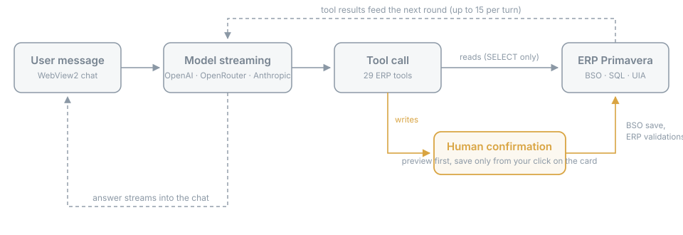
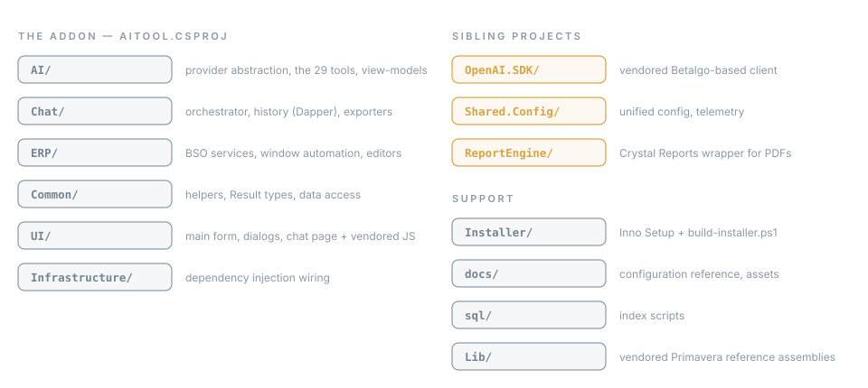

# Architecture (EN)

This repository hosts a WinForms extension for ERP Primavera v10 targeting .NET Framework 4.8 with DevExpress WinForms 21.2.3. The UI is classic WinForms with a modern chat surface powered by WebView2. Telemetry is centralized via NLog with Sentry integration for RELEASE builds.

## Solution layout

- **AITOOL** (WinForms app): Modular structure organized by domain/functionality:
  - `/AI` - Provider abstraction (`Providers/`), ViewModels, Services, Tools
  - `/Chat` - Chat functionality (Models, Repository, Services, ViewModels, Export)
  - `/ERP` - Primavera integration (Editores, Services, automation)
  - `/Common` - Shared utilities (Extensions, Helpers, Utils, Models, Results, Data)
  - `/UI` - User interface (Forms, Dialogs, Resources, Views, Messaging, Services)
  - `/Infrastructure` - DI (ServiceProviderFactory, ServiceConfigurator)
- **Shared.Config** (class library): TelemetryService (NLog backend), TelemetryInitializer (Sentry), UnifiedConfig, ConfigurationService, ProviderPresets, ModelCapabilities
- **OpenAI.SDK** (class library): Standalone Betalgo OpenAI client (no dependency on AITOOL)
- **ReportEngine** (class library): Crystal Reports wrapper behind the official document PDFs
- **Installer** (build-only project): drives the Inno Setup build; only built under the `Installer` solution configuration

## Core data flow

1) User interacts with chat in WebView2 (HTML/JS)
2) JS posts messages to C# via WebView2 WebMessageReceived
3) ChatAIViewModel builds a message chain and serializes ERP context (JSON)
4) ToolCallOrchestrator (Chat/Services) runs the turn: streams via the provider abstraction, executes ERP tool calls (up to the iteration cap), replays the tool transcript on continuations, and owns per-turn cancellation
5) Streaming deltas are marshaled back to JS for progressive rendering
6) TelemetryService logs request/response, timings, and token usage

## WebView2 integration

- The chat surface (`UI/Resources/Chat/index.html`) is served from a WebView2 virtual host (`https://aitool.local` mapped onto the loose `UI\Resources\Chat` folder next to AITOOL.dll), giving the page a real origin
- marked, DOMPurify, highlight.js and Mermaid are vendored under `UI/Resources/Chat/vendor/` with pinned versions and SRI hashes — the chat renders fully offline; the CSP allows no CDN hosts
- Fallback: when the loose folder is missing, the embedded copy of index.html loads via NavigateToString and rendering degrades gracefully (plain text, no vendor libs)
- JavaScript communicates with C# using PostWebMessageAsJson; C# replies via ExecuteScriptAsync
- UTF-8 safety: when rendering HTML inside iframes, we inject <meta charset="UTF-8"> and common CSS using an injectStyle() helper to prevent garbled characters

## OpenAI usage

- Provider abstraction (OpenAI / OpenRouter / native Anthropic / OpenAI-compatible) with streaming
- On api.openai.com a reasoning model with tools goes to `/v1/responses` (OpenAiResponsesClient), not Chat Completions: from gpt-5.4 on Chat Completions takes tools only with reasoning off, and gpt-6.1-sol and gpt-6-astra cannot turn it off. Stateless (`store: false`); the encrypted reasoning travels back with each tool round. OpenRouter converts on its side and keeps Chat Completions
- A 400 that names a refused parameter or value (`max_tokens`, an effort the model does not take, a Responses field) is learned once per process by ModelRequestQuirks and the request is sent again before anything reaches the chat
- Temperature defaults to 0.7 (configurable in-app; gated off for reasoning models)
- Context window optimization with a sliding window and a token safety margin
- ERP context is consolidated into a single System message with explicit validation rules and JSON fences

## Telemetry and logging

- Centralized via Shared.Config.TelemetryService (NLog 6.x)
- DEBUG: Trace..Fatal to local rolling file; RELEASE: Info..Fatal to file, Error..Fatal to Sentry (Sentry.NLog)
- BeforeSend/BeforeBreadcrumb hooks sanitize secrets and reduce noise
- Use TelemetryService.LogDebug/Info/Warning/Error/Fatal and AddBreadcrumb

## ERP integration safety

- Never write directly to ERP core tables. Writes go through the Primavera BSO object model,
  in `ERP/Services/ErpCreationService.cs`:
  - `commit=false` runs the ERP's own `ValidaActualizacao` and returns a preview, saving nothing
  - `commit=true` calls `Actualiza` on the BSO, so the ERP assigns numbers and enforces its rules
  - Each document uses the engine the ERP itself uses for it: sales and purchases through
    their document services, receipts, payments and encontros through `Liquidacoes`, state
    changes such as the payment approval (type-5 documents) through `Transferencias` with a
    `CctBEDocumentoTransf`, which `Liquidacoes` refuses
  - Commits are single-flight; a second concurrent commit is refused
  - Every commit, refusal and failure is written to `AI_AuditLog` by `ErpToolsService`
- The commit is gated in `ErpToolsService`: the preview pass makes `WriteConfirmationStore`
  issue a single-use token (15 minutes, bound to a hash of tool + arguments), the card built
  by `WriteConfirmationCard` carries it, and the user's click returns it as
  `_confirm_token`. `TryConsume` must match before `commit=true` runs; a `confirm=true` call
  without it is refused and audited as `Recusou (sem confirmação no cartão)`. The model never
  sees the token. See SECURITY.md.

## Performance rules

- DevExpress: server-side filtering/sorting; virtual mode for large grids; repository item reuse
- SQL Server: parameterized queries; NOLOCK where existing behavior relies on it; avoid ballooning LOH allocations
- Token management: enforce headroom for response generation; compact context where possible

## Build/compatibility

- .NET Framework 4.8 only; DevExpress WinForms 21.2.3; ERP Primavera v10 SDK
- Do not introduce .NET 5+ APIs or WPF
- Keep OpenAI.SDK independent from AITOOL (no cross-references)

## Packaging/deploy

- Costura.Fody (6.2) embeds most NuGet dependencies into AITOOL.dll (~17 MB) and removes their loose copies from the output; DevExpress*, Shared.Config, ReportEngine and a few runtime libraries are excluded and ship loose
- Deploys must mirror the FULL build output folder into `…\SG100\Config\<EV|LE|LP>\Extensions\AITOOL` (one folder per installed edition, including `UI\Resources\Chat`), removing files that are no longer produced — a stale loose DLL shadows its embedded replacement because the CLR probes the app-base folder first

## Anatomy of a turn

The addon is hosted in-process by the ERP. The chat surface is a WebView2 page served from a
virtual host (`https://aitool.local`) with a CSP that allows no CDN — marked, DOMPurify,
highlight.js and Mermaid are vendored with pinned versions and SRI hashes, so rendering works
fully offline. JS and C# talk over `PostWebMessageAsJson` / `ExecuteScriptAsync`, abstracted
behind an `IChatView` interface.

A turn runs through the `ToolCallOrchestrator`: it streams from the active provider, executes
tool calls up to the configured iteration cap (1-15), replays the tool transcript on
continuations, and owns per-turn cancellation. Providers sit behind an `IAiProvider`
abstraction — one implementation for OpenAI-compatible endpoints and a native Anthropic
adapter (`/v1/messages`, thinking with effort levels, prompt caching). Tools implement
`IErpTool`, are marked with `[Tool]`, and are discovered by reflection at startup.

Five projects make up the solution: **AITOOL** (the addon), **OpenAI.SDK** (vendored
Betalgo-based client — streaming and tool calling, no dependency on AITOOL),
**Shared.Config** (unified configuration + telemetry), **ReportEngine** (Crystal Reports
wrapper used for the official document PDFs) and **Installer** (drives the Inno Setup
build).

## Design trade-offs

Choices that look odd from the outside and are deliberate:

- **.NET Framework 4.8.** The addon runs in-process inside the Primavera v10 client, which is
  a .NET Framework host. The runtime is imposed, not chosen — no .NET 5+ APIs anywhere.
- **WinForms + WebView2.** The host is WinForms/DevExpress; rebuilding the shell was never on
  the table. The chat needed a modern surface, so it is a WebView2 page with all rendering
  libraries vendored — no CDN, works offline, and the CSP enforces it.
- **UIA fallback for window automation.** Primavera still ships classic VB6-era editors that
  the .NET object model cannot see. Automation tries the in-process object model first and
  falls back to UI Automation (FlaUI/UIA3) on a dedicated worker thread — slower, but it makes
  native windows scriptable too.
- **No test projects.** Verification is a clean build plus a run inside the ERP. Nearly every
  meaningful behavior depends on a licensed live host — BSO/PSO objects, DevExpress editors,
  WebView2 — so unit tests here would mostly exercise mocks of exactly the parts that break.
  A trade-off, not a virtue.
- **Vendored OpenAI SDK.** A Betalgo-based client lives in-repo (`OpenAI.SDK`) instead of a
  NuGet dependency: it needed .NET Framework 4.8 compatibility, native Anthropic support and
  streaming/tool-calling behavior tuned for this addon, without upstream drift. It stays
  standalone — no reference back to AITOOL.

## Repository layout

---

# Arquitetura (PT)

Este repositório contém uma extensão WinForms para o ERP Primavera v10 direcionada ao .NET Framework 4.8 com DevExpress WinForms 21.2.3. A UI é WinForms clássico com uma superfície moderna de chat suportada por WebView2. A telemetria é centralizada via NLog com integração Sentry para builds RELEASE.

## Estrutura da solução

- **AITOOL** (WinForms app): Estrutura modular organizada por domínio/funcionalidade:
  - `/AI` - Abstração de fornecedores (`Providers/`), ViewModels, Services, Tools
  - `/Chat` - Funcionalidade de chat (Models, Repository, Services, ViewModels, Export)
  - `/ERP` - Integração Primavera (Editores, Services, automação)
  - `/Common` - Utilitários partilhados (Extensions, Helpers, Utils, Models, Results, Data)
  - `/UI` - Interface de utilizador (Forms, Dialogs, Resources, Views, Messaging, Services)
  - `/Infrastructure` - DI (ServiceProviderFactory, ServiceConfigurator)
- **Shared.Config** (biblioteca): TelemetryService (NLog), TelemetryInitializer (Sentry), UnifiedConfig, ConfigurationService, ProviderPresets, ModelCapabilities
- **OpenAI.SDK** (biblioteca): Cliente Betalgo OpenAI standalone (sem dependência do AITOOL)
- **ReportEngine** (biblioteca): Wrapper de Crystal Reports por trás dos PDFs oficiais
- **Installer** (projeto só de build): conduz a construção do Inno Setup; só é compilado na configuração `Installer` da solução

## Fluxo de dados principal

1) Utilizador interage com o chat no WebView2 (HTML/JS)
2) JS comunica com C# via WebMessageReceived
3) ChatAIViewModel constrói a cadeia de mensagens e serializa o contexto ERP (JSON)
4) ToolCallOrchestrator (Chat/Services) executa o turno: streaming via a abstração de fornecedores, execução das ferramentas ERP (até ao limite de iterações), replay do transcript nas continuações, e cancelamento por turno
5) Deltas de streaming são enviados de volta para JS para rendering progressivo
6) TelemetryService regista pedido/resposta, tempos e uso de tokens

## Integração WebView2

- A superfície de chat (`UI/Resources/Chat/index.html`) é servida por um virtual host do WebView2 (`https://aitool.local` mapeado para a pasta solta `UI\Resources\Chat` ao lado do AITOOL.dll), dando um origin real à página
- marked, DOMPurify, highlight.js e Mermaid estão vendorizados em `UI/Resources/Chat/vendor/` com versões fixas e hashes SRI — o chat renderiza totalmente offline; a CSP não permite hosts CDN
- Fallback: se a pasta solta faltar, a cópia embebida do index.html carrega via NavigateToString e o rendering degrada graciosamente (texto simples, sem bibliotecas vendorizadas)
- JavaScript comunica com C# usando PostWebMessageAsJson; C# responde via ExecuteScriptAsync
- Segurança UTF-8: ao renderizar HTML em iframes, injetamos <meta charset="UTF-8"> e CSS comum com a função injectStyle() para evitar caracteres corrompidos

## Uso do OpenAI

- Abstração de fornecedores (OpenAI / OpenRouter / Anthropic nativo / compatível) com streaming
- Em api.openai.com, um modelo de raciocínio com ferramentas vai para `/v1/responses` (OpenAiResponsesClient) e não para Chat Completions: a partir do gpt-5.4 o Chat Completions só aceita ferramentas com o raciocínio desligado, e o gpt-6.1-sol e o gpt-6-astra não o deixam desligar. Sem estado (`store: false`); o raciocínio cifrado volta com cada ronda de ferramentas. O OpenRouter faz a conversão do lado dele e fica em Chat Completions
- Um 400 que nomeia um parâmetro ou valor recusado (`max_tokens`, um esforço que o modelo não aceita, um campo da Responses) é aprendido uma vez por processo pelo ModelRequestQuirks e o pedido volta a sair antes de chegar alguma coisa ao chat
- Temperature por defeito 0.7 (configurável na app; desativada em modelos de raciocínio)
- Otimização da janela de contexto com sliding window e margem de segurança de tokens
- Contexto ERP consolidado numa única System message com regras explícitas de validação e fences JSON

## Telemetria e logging

- Centralizado via Shared.Config.TelemetryService (NLog 6.x)
- DEBUG: Trace..Fatal para ficheiro local rotativo; RELEASE: Info..Fatal para ficheiro, Error..Fatal para Sentry (Sentry.NLog)
- Hooks BeforeSend/BeforeBreadcrumb sanitizam segredos e reduzem ruído
- Usar TelemetryService.LogDebug/Info/Warning/Error/Fatal e AddBreadcrumb

## Segurança na integração ERP

- Nunca escrever diretamente nas tabelas core do ERP. As escritas passam pelo modelo de
  objetos BSO da Primavera, em `ERP/Services/ErpCreationService.cs`:
  - `commit=false` corre o `ValidaActualizacao` do próprio ERP e devolve uma pré-visualização, sem gravar
  - `commit=true` chama `Actualiza` no BSO, para o ERP atribuir números e aplicar as suas regras
  - Cada documento usa o motor que o próprio ERP usa para ele: vendas e compras pelos serviços
    de documentos, recibos, pagamentos e encontros por `Liquidacoes`, mudanças de estado como
    a aprovação para pagamento (documentos de tipo 5) por `Transferencias` com um
    `CctBEDocumentoTransf`, que o `Liquidacoes` recusa
  - As gravações são single-flight; uma segunda gravação concorrente é recusada
  - Cada gravação, recusa e falha é registada em `AI_AuditLog` pelo `ErpToolsService`
- O commit tem portão no `ErpToolsService`: a passagem de pré-visualização faz o
  `WriteConfirmationStore` emitir uma autorização de uso único (15 minutos, ligada a um hash
  de tool + argumentos), o cartão construído pelo `WriteConfirmationCard` transporta-a, e o
  clique do utilizador devolve-a como `_confirm_token`. O `TryConsume` tem de coincidir antes
  de o `commit=true` correr; uma chamada com `confirm=true` sem ela é recusada e auditada como
  `Recusou (sem confirmação no cartão)`. O modelo nunca vê a autorização. Ver SECURITY.md.

## Regras de performance

- DevExpress: filtragem/ordenação no servidor; modo virtual para grelhas grandes; reutilização de RepositoryItems
- SQL Server: queries parametrizadas; manter NOLOCK onde o comportamento existente depende disso; evitar alocações LOH
- Gestão de tokens: reservar espaço para a resposta; compactar contexto quando possível

## Build/compatibilidade

- Apenas .NET Framework 4.8; DevExpress WinForms 21.2.3; SDK do ERP Primavera v10
- Não introduzir APIs .NET 5+ ou WPF
- Manter OpenAI.SDK independente do AITOOL (sem referências cruzadas)

## Empacotamento/deploy

- O Costura.Fody (6.2) embebe a maioria das dependências NuGet no AITOOL.dll (~17 MB) e remove as cópias soltas do output; DevExpress*, Shared.Config, ReportEngine e algumas bibliotecas de runtime estão excluídos e seguem soltos
- O deploy tem de espelhar a pasta de output COMPLETA para `…\SG100\Config\<EV|LE|LP>\Extensions\AITOOL` (uma pasta por edição instalada, incluindo `UI\Resources\Chat`), removendo ficheiros que já não são produzidos — um DLL solto obsoleto faz shadowing da cópia embebida porque o CLR sonda primeiro a pasta base

## Anatomia de um turno

O addon é alojado in-process pelo ERP. A superfície de chat é uma página WebView2 servida a
partir de um host virtual (`https://aitool.local`) com uma CSP que não permite nenhum CDN —
marked, DOMPurify, highlight.js e Mermaid são vendored com versões fixas e hashes SRI, pelo
que a renderização funciona totalmente offline. JS e C# comunicam por `PostWebMessageAsJson`
/ `ExecuteScriptAsync`, abstraídos atrás de uma interface `IChatView`.

Um turno corre através do `ToolCallOrchestrator`: faz streaming do fornecedor ativo, executa
tool calls até ao limite de iterações configurado (1-15), reproduz o transcript de tools nas
continuações e é dono do cancelamento por turno. Os fornecedores estão atrás de uma
abstração `IAiProvider` — uma implementação para endpoints compatíveis com OpenAI e um
adaptador Anthropic nativo (`/v1/messages`, thinking com níveis de esforço, prompt caching).
As tools implementam `IErpTool`, são marcadas com `[Tool]` e são descobertas por reflexão no
arranque.

Cinco projetos compõem a solução: **AITOOL** (o addon), **OpenAI.SDK** (cliente vendored
baseado no Betalgo — streaming e tool calling, sem dependência do AITOOL), **Shared.Config**
(configuração unificada + telemetria), **ReportEngine** (wrapper de Crystal Reports usado
para os PDFs oficiais de documentos) e **Installer** (conduz a construção do Inno Setup).

## Trade-offs de design

Escolhas que parecem estranhas vistas de fora e são deliberadas:

- **.NET Framework 4.8.** O addon corre in-process dentro do cliente Primavera v10, que é um
  host .NET Framework. O runtime é imposto, não escolhido — nenhuma API .NET 5+ em lado
  nenhum.
- **WinForms + WebView2.** O host é WinForms/DevExpress; reconstruir a shell nunca esteve em
  cima da mesa. O chat precisava de uma superfície moderna, por isso é uma página WebView2
  com todas as bibliotecas de renderização vendored — sem CDN, funciona offline, e a CSP
  obriga a isso.
- **Fallback UIA para a automação de janelas.** O Primavera ainda traz editores clássicos da
  era VB6 que o modelo de objetos .NET não vê. A automação tenta primeiro o modelo de
  objetos in-process e recorre a UI Automation (FlaUI/UIA3) numa worker thread dedicada —
  mais lento, mas torna as janelas nativas automatizáveis também.
- **Sem projetos de teste.** A verificação é um build limpo mais uma execução dentro do ERP.
  Quase todos os comportamentos relevantes dependem de um host vivo licenciado — objetos
  BSO/PSO, editores DevExpress, WebView2 — pelo que testes unitários aqui exercitariam
  sobretudo mocks exatamente das partes que se partem. Um trade-off, não uma virtude.
- **OpenAI SDK vendored.** Um cliente baseado no Betalgo vive no repositório (`OpenAI.SDK`)
  em vez de uma dependência NuGet: precisava de compatibilidade com .NET Framework 4.8, de
  suporte Anthropic nativo e de comportamento de streaming/tool calling afinado para este
  addon, sem deriva do upstream. Mantém-se independente — sem referência de volta ao AITOOL.

## Estrutura do repositório

