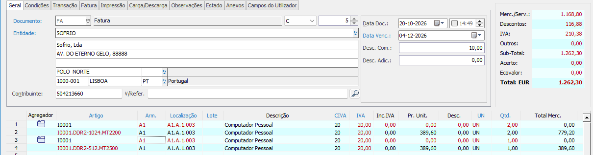
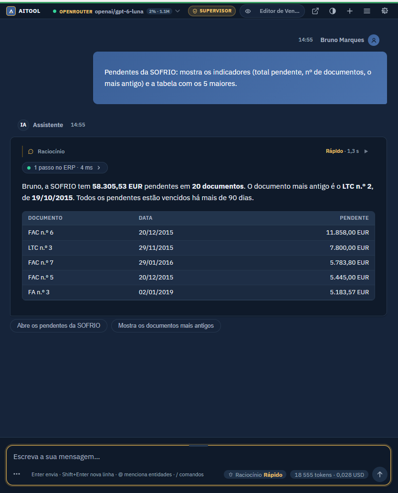
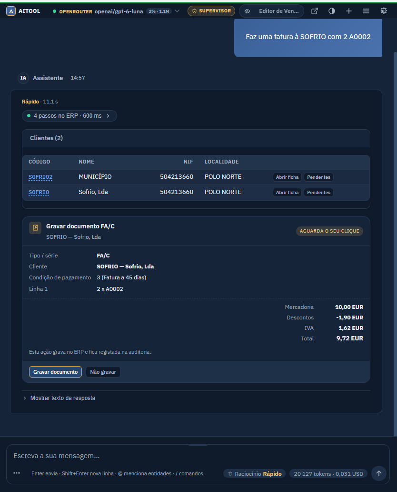
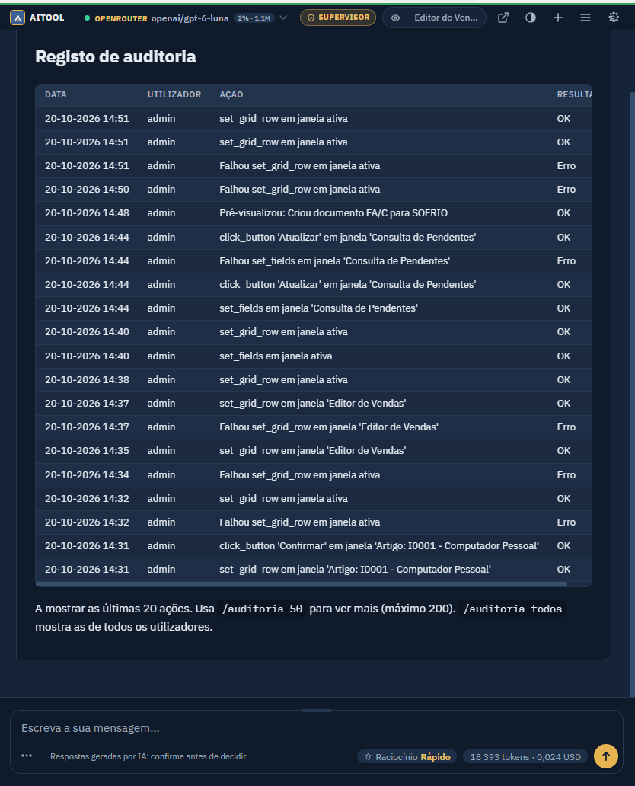
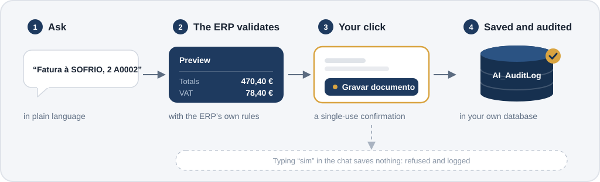
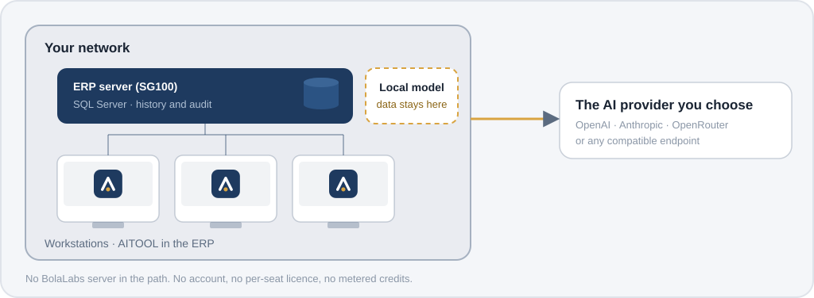
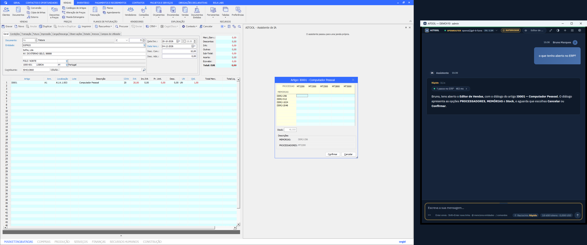
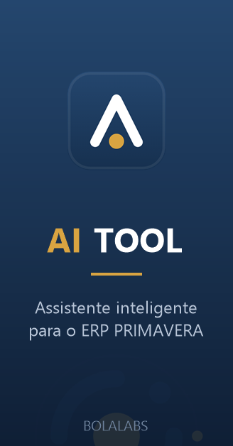

**English** | [Português](README.pt.md)

### The AI assistant that works inside PRIMAVERA: on your machines, with your model, and nothing saved without your click

Ask about your data, open any screen by name, fill windows and create documents in plain language.
No vendor account, no per-seat licence, no metered credits.

[-D9A441)](LICENSE)

**[Download](https://github.com/BolaLabs/AITOOL/releases/latest)** ·
[Watch the film](https://bolalabs.pt/en/aitool/#filme) ·
[User guide](docs/USER-GUIDE.md) ·
[Security](docs/SECURITY-AND-PRIVACY.md) ·
[Português](README.pt.md)

---

## Why AITOOL

<table>
<tr>
<td width="33%" valign="top">
 
<b>Runs where you decide</b> 
Inside the ERP, on your machines. No Bola Labs server in the path. OpenAI, Anthropic,
OpenRouter, any compatible endpoint, or a local model where nothing leaves the building.
</td>
<td width="33%" valign="top">
 
<b>Works in the ERP, not beside it</b> 
Answers with the ERP's own queries, opens any screen by name, fills the sales, purchase and
internal editors by text, and creates documents, receipts and payments.
</td>
<td width="33%" valign="top">
 
<b>Shows before it saves</b> 
The ERP validates every write first. The save needs your click on a confirmation card, and
every save, refusal and failure goes to an audit table in your database.
</td>
</tr>
</table>

## What you can ask

One request per area of the ERP. Those marked **saves** wait for your click on the card.

| Area | You type | What happens |
| --- | --- | --- |
| **Documents** | *"Faz uma fatura à SOFRIO com 2 A0002"* · **saves** | A preview with the ERP's totals, then a card with **Gravar documento** |
| **Editor lines** | *"Põe uma linha de 3 A0002 a 250 €"* | The line is written through the editor's own events; the ERP computes it |
| **Variants** | *"Põe 2 do I0001 com DDR2-1024 e MT2200 e 1 com DDR2-512 e MT2500"* | The ERP's variant grid is filled and confirmed: one line per variant under the article |
| **Formulas** | *"Põe 2 peças do A0005 com 1,5 de largura e 2 de comprimento"* | The measures go into the ERP's "Fórmula" dialog; the line takes the quantity it computes |
| **Receipts and payments** | *"Faz um recibo ao cliente SOFRIO de 100 euros"* · **saves** | Oldest debts first, the last one in part; every document and amount is on the card |
| **Approvals** | *"Aprova para pagamento as faturas do fornecedor F0003"* · **saves** | The ERP's APR document: the invoices move to Aprovada, nothing is paid |
| **Questions and screens** | *"Quais os pendentes da SOFRIO?"* | The ERP's own pending-items query, as KPI cards and a live table |
| **Official PDF** | *"Imprime a fatura FA C/4"* | The series' report with ATCUD and QR; the card offers Ver, Imprimir and Guardar como |

<b>More examples, by area</b>

**Documents and records** · **saves**
- *"Faz uma proposta ao SOFRIO com 2 A0001"*: a sales document with the ERP's prices and totals
- *"Lança a fatura do fornecedor F0003, documento FT 2026/123, 5 A0002 a 300 euros"*: a purchase document
- *"Cria o artigo AIT1018 "Cabo HDMI 2 m", unidade UN, IVA 23"*: an article record; the VAT code is never guessed

**Filling the editor**
- *"Muda a quantidade da linha 2 para 5"*: that line changes, the others stay
- *"Põe o cliente SOFRIO"*: the customer goes into the document and the ERP's name is read back
- *"Põe um I0001, que eu escolho as variantes na grelha"*: the grid opens for you, and the chat keeps answering in its own window

**Receipts, payments and settlement** · **saves**
- *"Paga 200 euros ao fornecedor F0001"*: a supplier payment
- *"Faz um encontro de contas do cliente SOFRIO de 150 euros"*: account offsetting (encontro de contas) between the customer and its supplier
- *"Recebe tudo o que o cliente MICROSOFTPOR deve"*: a receipt for the whole balance, credit notes included
- In the settlement editor, *"Põe 500 em valor a liquidar e distribui"*: Distribuição Automática spreads the amount over the oldest pending items; only Confirmar saves, through the card

**Screens and documents**
- *"Abre o explorador de vendas"*: the screen opens from the ribbon, in whatever module it lives
- *"O que tenho aberto no ERP?"*: the open windows and any ERP dialog waiting for an answer

The exact words for everything else: the [user guide](docs/USER-GUIDE.md).

## See it

An editor filled from one sentence, with prices and totals computed by the ERP.

<table>
<tr>
<td width="33%" valign="top"></td>
<td width="33%" valign="top"></td>
<td width="33%" valign="top"></td>
</tr>
<tr>
<td>Real data, with the ERP's own query.</td>
<td>Validated by the ERP, saved only on your click.</td>
<td>Every write in <code>AI_AuditLog</code>, in your database.</td>
</tr>
</table>

The [product page](https://bolalabs.pt/en/aitool/#filme) has the full film, recorded on the real ERP with v2.12 (September 2026).

## Nothing is saved without your click

- Every write goes through the PRIMAVERA business objects: the ERP's validations run and the numbering is the ERP's.
- The save needs a single-use token issued with the card you see. The model never sees it, and typing "sim" is refused and logged.
- A button that saves or destroys data in an ERP window goes through the same card.
- Supervisors (administrators and technicians) see every user's audit trail and conversations.

**The honest limit.** Reading tools query the database with the ERP's connection, so they do not
apply PRIMAVERA's per-user permissions. Switch tools off per user, or point the addon at a
read-only SQL login. Details: [Security and privacy](docs/SECURITY-AND-PRIVACY.md).

## Runs where you decide

- Install once on the server that holds `SG100`; every workstation gets the assistant at its next start.
- Each user brings a provider key, stored encrypted (Windows DPAPI) and sent only to that provider.
- You pay your provider directly. The session panel shows tokens and cost per request; a low-cost
  model such as `gpt-6-luna` handles day-to-day ERP work for a fraction of a flagship model.

## New in 2.21

| | |
| --- | --- |
| **The chat survives ERP dialogs** | When the ERP opens a window that blocks the rest, the chat moves to its own window and keeps answering; it returns when the window closes |
| **Articles with variants, by sentence** | "2 of I0001 with DDR2-1024 and MT2200": the assistant fills the ERP's variant grid and the ERP adds the lines, as if you had picked them |
| **Formula articles** | Width and length go into the ERP's "Fórmula" dialog and the line carries the quantity the ERP computes |

Every release: [CHANGELOG.md](CHANGELOG.md).

## Install

1. **[Download the installer](https://github.com/BolaLabs/AITOOL/releases/latest)** and check its SHA256 against the release notes (the setup is not code-signed yet, so SmartScreen warns once).
2. **Run it on the machine that holds `SG100`.** It finds PRIMAVERA, checks the workstation, registers the addon in the Extensibility screen and verifies the result.
3. **Open PRIMAVERA**, click the assistant on the ribbon, choose a provider and paste your key.

**Requirements:** PRIMAVERA v10.20 or later (Evolution and Executive validated; Professional
pending a customer confirmation) · .NET Framework 4.8 · Microsoft Edge WebView2 (the setup
installs both when missing) · the ERP's SQL Server · a provider key, or a local
OpenAI-compatible endpoint such as LM Studio.

Silent deployment and manual steps: [INSTALL.md](INSTALL.md).

<b>The 29 tools</b>

| Tool | What it does |
| --- | --- |
| `search_entities` | Searches customers, suppliers and articles by name, code, tax id (NIF) or city |
| `get_entity_details` | Full details of a customer, supplier or article whose record is open in the ERP |
| `get_pending_items` | Pending documents per entity, or across all entities; accepts date arguments |
| `query_account_balance` | Current-account balance for a customer/supplier, with aging buckets |
| `query_documents` | Searches commercial documents by type, entity, date or status |
| `analyze_sales` | Sales by customer, article or period; top-N and period comparison, net of credit notes and returns |
| `check_stock` | Current, minimum and maximum stock of an article per warehouse |
| `render_document` | Header and lines of a commercial document, shown as an interactive card |
| `run_query` | Model-written read-only SQL: `SELECT`/`WITH` only, writes and DDL blocked by a guard |
| `open_record` | Opens a record (file, document, account statement) in its native ERP editor |
| `open_erp_function` | Opens any ERP function by name, navigating the ribbon |
| `interact_erp_window` | Lists windows and fields, fills fields and grid lines, clicks buttons, on .NET and VB6 windows |
| `erp_steps` | Runs a sequence of ERP steps in one call, stopping at the first failure or confirmation |
| `print_document` | The official report PDF of a document; the card offers Ver, Imprimir and Guardar como |
| `get_sales_document_types` | The sales document types of this installation, with the nature the ERP gives each |
| `get_sales_series` | The series of a document type, with default and today's validity |
| `get_article_price` | Suggested price and discount from the ERP's price rules |
| `create_entity` | Creates a customer or supplier file, saved from the confirmation card |
| `create_sales_document` | Creates a sales document with the ERP's totals, saved from the confirmation card |
| `create_purchase_document` | Creates a supplier invoice or order, saved from the confirmation card |
| `create_settlement` | Receipts, supplier payments, payment approvals and encontros de contas, saved from the card |
| `update_entity` | Updates fields of a customer or supplier file, saved from the confirmation card |
| `create_article` | Creates an article with unit, VAT code and price; the VAT code is never guessed |
| `update_sales_series` | Extends or reactivates a sales series that ran out (administrators and technicians) |
| `create_opportunity` | Creates a CRM sales opportunity for an existing customer |
| `draft_email` | Prepares an e-mail draft you open in your own mail client; nothing is sent |
| `use_skill` | Loads a skill: a workflow written in Markdown, see [docs/SKILLS.md](docs/SKILLS.md) |
| `enrich_entity` | Fills a file from public registries by tax id (VIES, NIF.pt), with a field-by-field diff |
| `web_search` | Public web search (Brave, Tavily, Exa, Serper or SearXNG); results flagged as untrusted |

Each tool switches off individually in Settings → Ferramentas; `ErpTools:Enabled` turns the whole layer off.

## Limits

- No accounting postings, no voiding or deleting documents.
- No invoice intake from a PDF yet: it is on the [roadmap](ROADMAP.md).
- No Excel export of result tables: tables offer copy, conversations export to Markdown, HTML or text.
- No unattended runs: every turn has a step limit and every write waits for your click.
- Tool calling is required: below roughly 8B parameters at 4-bit, local models stop being reliable.
- The interface is Portuguese (pt-PT); the assistant answers in the language you write in.

## Documentation

| | |
| --- | --- |
| [User guide](docs/USER-GUIDE.md) | Day-to-day use, with the words to type |
| [Install](INSTALL.md) | Installation, silent mode, client-server notes |
| [Security and privacy](docs/SECURITY-AND-PRIVACY.md) | What leaves the machine, what is stored, what bounds the assistant |
| [Skills](docs/SKILLS.md) | Teach it your own workflows in Markdown |
| [Configuration](docs/CONFIGURATION.md) | Every setting and environment variable |
| [Architecture](ARCHITECTURE.md) | How a turn runs, design trade-offs, the repository |
| [Roadmap](ROADMAP.md) | What comes next, and what is out of scope |
| [Changelog](CHANGELOG.md) | Every release |

Questions and reports: [Issues and Discussions](https://github.com/BolaLabs/AITOOL/issues), see
[CONTRIBUTING.md](CONTRIBUTING.md). Anything private (a deployment, a partnership, a security
report): <bruno@bolalabs.pt>. Partners and source licences: [COMMERCIAL.md](COMMERCIAL.md).

## License

[AITOOL Community License](LICENSE): free for any use, including commercial, and for
redistributing the unmodified installer; not open source. Third-party components keep their own
licences ([notices](THIRD-PARTY-NOTICES.md), [distribution](DISTRIBUTION.md)). PRIMAVERA and Cegid
are trademarks of Cegid; AITOOL is not affiliated with or endorsed by Cegid
([trademarks](TRADEMARKS.md), [brand](docs/brand/README.md)).

Built by **Bola Labs** for Cegid PRIMAVERA v10 · Copyright 2025-2026 Bruno Marques

