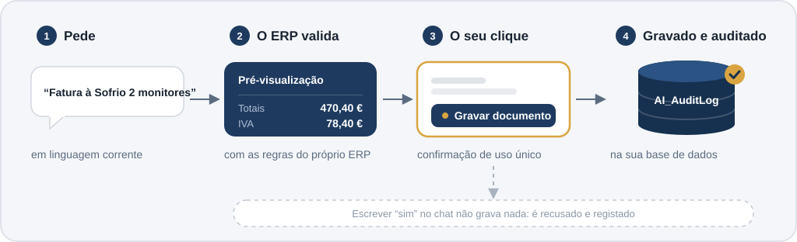
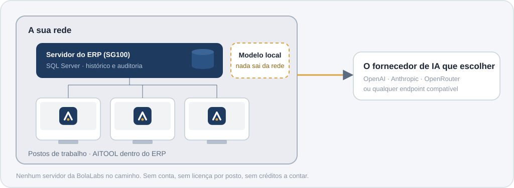
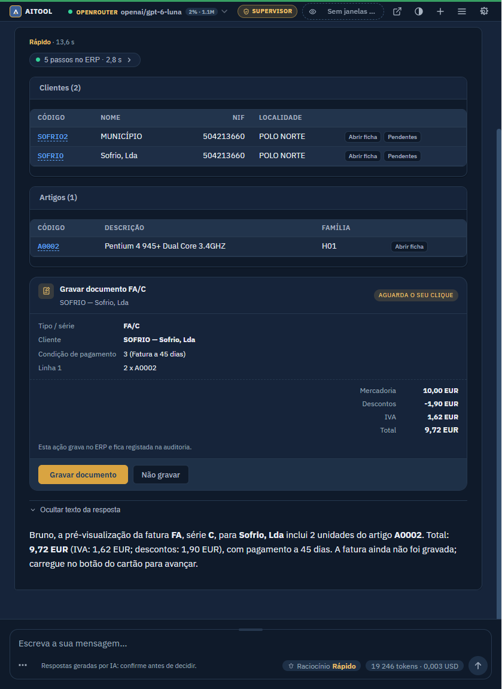

[English](README.md) | **Português**

# AITOOL para PRIMAVERA

**O assistente de IA que trabalha dentro do PRIMAVERA: nas suas máquinas, com o seu modelo, e nada gravado sem o seu clique**

Pergunte pelos seus dados, abra qualquer ecrã pelo nome, preencha janelas e crie documentos em linguagem corrente.
Sem conta no fabricante, sem licença por posto, sem créditos a contar.

[-D9A441)](LICENSE.pt)

**[Descarregar](https://github.com/BolaLabs/AITOOL/releases/latest)** ·
[Instalar](#instalar) ·
[Ver o filme](https://bolalabs.pt/pt/aitool/#filme) ·
[Guia do utilizador](docs/USER-GUIDE.pt.md) ·
[Segurança](docs/SECURITY-AND-PRIVACY.pt.md) ·
[English](README.md)

---

## Porquê o AITOOL

<table>
<tr>
<td width="33%" valign="top">
 
<b>Corre onde decidir</b> 
Dentro do ERP, nas suas máquinas. Nenhum servidor da Bola Labs no caminho. OpenAI, Anthropic,
OpenRouter, qualquer endpoint compatível, ou um modelo local de onde nada sai.
</td>
<td width="33%" valign="top">
 
<b>Trabalha no ERP, não ao lado</b> 
Responde com os dados vivos do ERP (os pendentes pela consulta do próprio ERP), abre qualquer
ecrã pelo nome, preenche os editores de vendas, compras e internos por texto, e cria documentos,
recibos e pagamentos.
</td>
<td width="33%" valign="top">
 
<b>Mostra antes de gravar</b> 
O ERP valida cada escrita primeiro. A gravação precisa do seu clique num cartão de confirmação,
e cada gravação, recusa e falha fica numa tabela de auditoria na sua base de dados.
</td>
</tr>
</table>

## O que pode pedir

Um pedido por área do ERP. O que está marcado com **grava** fica à espera do seu clique no cartão.

| Área | Escreve | O que acontece |
| --- | --- | --- |
| **Documentos** | *"Faz uma fatura à SOFRIO com 2 A0002"* · **grava** | Uma pré-visualização com os totais do ERP e um cartão com **Gravar documento** |
| **Linhas no editor** | *"Põe uma linha de 3 A0002 a 250 €"* | A linha é escrita pelos eventos do próprio editor; quem a calcula é o ERP |
| **Variantes** | *"Põe 2 do I0001 com DDR2-1024 e MT2200 e 1 com DDR2-512 e MT2500"* | A grelha de variantes do ERP é preenchida e confirmada: uma linha por variante sob o artigo |
| **Fórmulas** | *"Põe 2 peças do A0005 com 1,5 de largura e 2 de comprimento"* | As medidas vão para a janela "Fórmula" do ERP; a linha fica com a quantidade que ele calcula |
| **Recibos e pagamentos** | *"Faz um recibo ao cliente SOFRIO de 100 euros"* · **grava** | Liquida primeiro as dívidas mais antigas, a última em parte; cada documento e valor está no cartão |
| **Aprovações** | *"Aprova para pagamento as faturas do fornecedor F0003"* · **grava** | O documento APR do ERP: as faturas passam a Aprovada, nada é pago |
| **Perguntas e ecrãs** | *"Quais os pendentes da SOFRIO?"* | A consulta de pendentes do próprio ERP, em cartões e numa tabela viva |
| **PDF oficial** | *"Imprime a fatura FA C/4"* | O mapa da série com ATCUD e QR; o cartão tem Ver, Imprimir e Guardar como |

<b>Mais exemplos, por área</b>

**Documentos e fichas** · **grava**
- *"Faz uma proposta à SOFRIO com 2 A0001"*: um documento de venda com os preços e totais do ERP
- *"Lança a fatura do fornecedor F0003, documento FT 2026/123, 5 A0002 a 300 euros"*: um documento de compra
- *"Cria o artigo AIT1018 'Cabo HDMI 2 m', unidade UN, IVA 23"*: uma ficha de artigo; o código de IVA nunca é adivinhado

**Preencher o editor**
- *"Muda a quantidade da linha 2 para 5"*: muda essa linha, as outras ficam
- *"Põe o cliente SOFRIO"*: o cliente entra no documento e o nome que o ERP mostra é confirmado
- *"Põe um I0001, que eu escolho as variantes na grelha"*: a grelha abre para si, e o chat continua a responder na sua própria janela

**Recibos, pagamentos e encontros de contas** · **grava**
- *"Paga 200 euros ao fornecedor F0001"*: um pagamento a fornecedor
- *"Faz um encontro de contas do cliente SOFRIO de 150 euros"*: compensa o saldo do cliente com o do fornecedor
- *"Recebe tudo o que o cliente MICROSOFTPOR deve"*: um recibo do saldo todo, notas de crédito incluídas
- No editor de liquidações, *"Põe 500 em valor a liquidar e distribui"*: a Distribuição Automática reparte o valor pelos pendentes mais antigos; só o Confirmar grava, e passa pelo cartão

**Ecrãs e documentos**
- *"Abre o explorador de vendas"*: o ecrã abre a partir do friso, seja qual for o módulo
- *"O que tenho aberto no ERP?"*: as janelas abertas e qualquer diálogo do ERP à espera de resposta

As palavras exatas para tudo o resto: o [guia do utilizador](docs/USER-GUIDE.pt.md).

## Veja

Um editor preenchido a partir de uma frase, com os preços e os totais calculados pelo ERP.

<table>
<tr>
<td width="33%" valign="top"></td>
<td width="33%" valign="top"></td>
<td width="33%" valign="top"></td>
</tr>
<tr>
<td>Dados reais, com a consulta do próprio ERP.</td>
<td>Validado pelo ERP, gravado só com o seu clique.</td>
<td>Cada escrita em <code>AI_AuditLog</code>, na sua base de dados.</td>
</tr>
</table>

A [página do produto](https://bolalabs.pt/pt/aitool/#filme) tem o filme completo, gravado no ERP real com a v2.12 (setembro de 2026).

## Nada é gravado sem o seu clique

- Cada escrita passa pelos objetos de negócio do PRIMAVERA: correm as validações do ERP e a numeração é a do ERP.
- A gravação precisa de um token de uso único emitido com o cartão que vê. O modelo nunca o vê, e escrever "sim" é recusado e registado.
- Um botão que grava ou destrói dados numa janela do ERP passa pelo mesmo cartão.
- Os supervisores (administradores, superadministradores e técnicos do ERP) veem a auditoria e as conversas de todos os utilizadores.

**O limite honesto.** As ferramentas de leitura consultam a base de dados com a ligação do ERP, por isso
não aplicam as permissões por utilizador do PRIMAVERA. Desligue ferramentas por utilizador, ou aponte
o addon a um login SQL só de leitura. Detalhes: [Segurança e privacidade](docs/SECURITY-AND-PRIVACY.pt.md).

## Corre onde decidir

- Instala-se uma vez no servidor que tem o `SG100`; todos os postos recebem o assistente no arranque seguinte.
- Cada utilizador usa a sua chave do fornecedor, guardada cifrada (Windows DPAPI) e enviada só a esse fornecedor.
- Paga ao fornecedor diretamente. O painel da sessão mostra tokens e custo por pedido; um modelo económico
  como o `gpt-6-luna` faz o trabalho do dia a dia no ERP por uma fração de um modelo topo de gama.

## Novidades da 2.22

| | |
| --- | --- |
| **Artigos pelo nome, armazéns pelo código** | "Põe 2 do processador Intel" põe esse artigo na linha e "armazém 2" passa a A2; quando servem vários, pergunta em vez de escrever |
| **Os pedidos do guia chegam à ferramenta certa** | "Faz uma proposta à SOFRIO…" e "Quais os pendentes da SOFRIO?" vão às ferramentas de documentos e de pendentes, não ao SQL; "Põe 1 A0007 branco" escolhe a variante e "jmf" encontra a J.M.F. |
| **Continue a escrever enquanto responde** | A caixa de mensagem fica aberta durante a resposta; um pedido enviado com Enter segue quando a resposta acaba, e o Esc para-a |
| **A gravação acontece no cartão** | Gravar maior, bem distinto do "Não gravar", o progresso e o número do ERP no próprio cartão, e as linhas que o ERP acrescenta sozinho listadas antes de gravar |

Todas as versões: [CHANGELOG.md](CHANGELOG.md).

## Instalar

1. **[Descarregue o instalador](https://github.com/BolaLabs/AITOOL/releases/latest)** e confira o SHA256 com as notas da versão (o setup ainda não está assinado, por isso o SmartScreen avisa uma vez).
2. **Corra-o na máquina que tem o `SG100`.** Encontra o PRIMAVERA, verifica o posto, regista o addon na Extensibilidade e confirma o resultado.
3. **Abra o PRIMAVERA** e, no friso, abra o separador **BOLA LABS** › **Assistente de IA**; escolha um fornecedor e cole a sua chave (ou indique um modelo local).

**Requisitos:** PRIMAVERA v10.20 ou superior (Evolution e Executive validados; Professional
a aguardar confirmação de um cliente) · .NET Framework 4.8 · Microsoft Edge WebView2 (o setup
instala ambos quando faltam) · o SQL Server do ERP · uma chave de um fornecedor, ou um endpoint
local compatível com a OpenAI, como o LM Studio.

Instalação silenciosa e passos manuais: [INSTALL.pt.md](INSTALL.pt.md).

<b>As 29 ferramentas</b>

| Ferramenta | O que faz |
| --- | --- |
| `search_entities` | Procura clientes, fornecedores e artigos por nome, código, NIF ou cidade |
| `get_entity_details` | Detalhes completos de um cliente, fornecedor ou artigo com a ficha aberta no ERP |
| `get_pending_items` | Pendentes por entidade ou de todas as entidades; aceita datas |
| `query_account_balance` | Saldo de conta corrente de cliente ou fornecedor, com antiguidade |
| `query_documents` | Procura documentos comerciais por tipo, entidade, data ou estado |
| `analyze_sales` | Vendas por cliente, artigo ou período; top-N e comparação, líquidas de notas de crédito e devoluções |
| `check_stock` | Stock atual, mínimo e máximo de um artigo por armazém |
| `render_document` | Cabeçalho e linhas de um documento comercial, num cartão interativo |
| `run_query` | SQL só de leitura escrito pelo modelo: só `SELECT`/`WITH`, escritas e DDL bloqueadas |
| `open_record` | Abre um registo (ficha, documento, extrato) no seu editor nativo do ERP |
| `open_erp_function` | Abre qualquer função do ERP pelo nome, navegando pelo friso |
| `interact_erp_window` | Lista janelas e campos, preenche campos e linhas de grelha, carrega em botões, em janelas .NET e VB6 |
| `erp_steps` | Corre uma sequência de passos no ERP numa só chamada, parando na primeira falha ou confirmação |
| `print_document` | O PDF oficial do relatório de um documento; o cartão oferece Ver, Imprimir e Guardar como |
| `get_sales_document_types` | Os tipos de documento de venda desta instalação, com a natureza que o ERP dá a cada um |
| `get_sales_series` | As séries de um tipo de documento, com a por omissão e a validade de hoje |
| `get_article_price` | Preço e desconto sugeridos pelas regras de preço do ERP |
| `create_entity` | Cria uma ficha de cliente ou fornecedor, gravada a partir do cartão de confirmação |
| `create_sales_document` | Cria um documento de venda com os totais do ERP, gravado a partir do cartão |
| `create_purchase_document` | Cria uma fatura ou encomenda de fornecedor, gravada a partir do cartão |
| `create_settlement` | Recibos, pagamentos a fornecedores, aprovações para pagamento e encontros de contas, a partir do cartão |
| `update_entity` | Altera campos de uma ficha de cliente ou fornecedor, gravada a partir do cartão |
| `create_article` | Cria um artigo com unidade, código de IVA e preço; o código de IVA nunca é adivinhado |
| `update_sales_series` | Prolonga ou reativa uma série de vendas que acabou (administradores e técnicos) |
| `create_opportunity` | Cria uma oportunidade de venda no CRM para um cliente existente |
| `draft_email` | Prepara um rascunho de e-mail que abre no seu cliente de e-mail; nada é enviado |
| `use_skill` | Carrega uma skill: um fluxo escrito em Markdown, ver [docs/SKILLS.pt.md](docs/SKILLS.pt.md) |
| `enrich_entity` | Preenche uma ficha a partir de registos públicos pelo NIF (VIES, NIF.pt), com diferenças campo a campo |
| `web_search` | Pesquisa na web (Brave, Tavily, Exa, Serper ou SearXNG); resultados marcados como não confiáveis |

Cada ferramenta desliga-se individualmente em Definições → Ferramentas; `ErpTools:Enabled` desliga a camada toda.

## Limites

- Não faz lançamentos de contabilidade, nem anula ou apaga documentos.
- Ainda não lança faturas de fornecedor a partir de um PDF ou de uma foto: é o primeiro ponto do [roadmap](ROADMAP.pt.md).
- Não exporta tabelas para Excel: as tabelas permitem copiar, as conversas exportam para Markdown, HTML ou texto.
- Não corre sem supervisão: cada turno tem um limite de passos e cada escrita espera pelo seu clique.
- Precisa de chamada de ferramentas: abaixo de cerca de 8B parâmetros a 4 bits, os modelos locais deixam de ser fiáveis.
- A interface é em português (pt-PT); o assistente responde na língua em que escreve.

## Documentação

| | |
| --- | --- |
| [Guia do utilizador](docs/USER-GUIDE.pt.md) | O dia a dia, com as palavras a escrever |
| [Instalação](INSTALL.pt.md) | Instalação, modo silencioso, notas cliente-servidor |
| [Segurança e privacidade](docs/SECURITY-AND-PRIVACY.pt.md) | O que sai da máquina, o que fica guardado, o que limita o assistente |
| [Skills](docs/SKILLS.pt.md) | Ensine-lhe os seus fluxos em Markdown |
| [Configuração](docs/CONFIGURATION.md) | Todas as definições e variáveis de ambiente |
| [Arquitetura](ARCHITECTURE.md) | Como corre um turno, compromissos de design, o repositório |
| [Roadmap](ROADMAP.pt.md) | O que vem a seguir, e o que não muda |
| [Changelog](CHANGELOG.md) | Todas as versões |

Perguntas e problemas: [Issues e Discussions](https://github.com/BolaLabs/AITOOL/issues), ver
[CONTRIBUTING.md](CONTRIBUTING.md). Assuntos privados (uma instalação, uma parceria, um relatório
de segurança): <bruno@bolalabs.pt>. Parceiros e licenças de código: [COMMERCIAL.md](COMMERCIAL.md).

## Licença

[Licença Community do AITOOL](LICENSE.pt): gratuita para qualquer uso, incluindo comercial, e para
redistribuir o instalador sem alterações; não é código aberto. Os componentes de terceiros mantêm as
suas licenças ([avisos](THIRD-PARTY-NOTICES.md), [distribuição](DISTRIBUTION.md)). PRIMAVERA e Cegid
são marcas da Cegid; o AITOOL não é afiliado nem endossado pela Cegid
([marcas](TRADEMARKS.md), [marca](docs/brand/README.md)).

Feito pela **Bola Labs** para o Cegid PRIMAVERA v10 · Copyright 2025-2026 Bruno Marques

